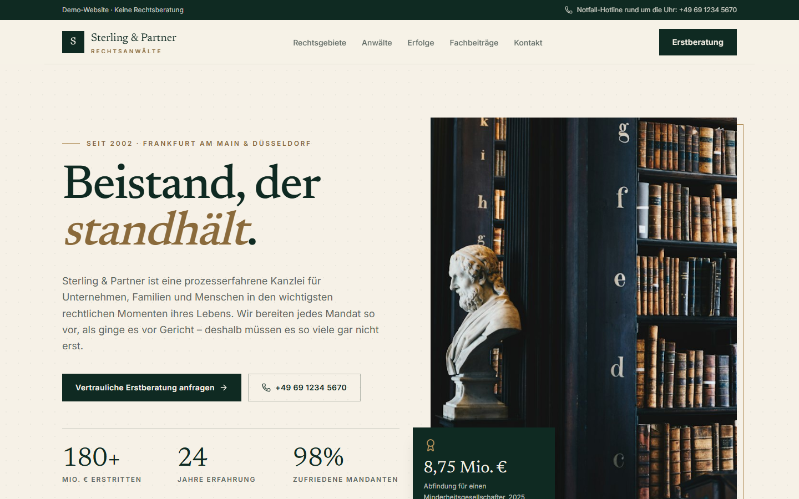

# Sterling & Partner Rechtsanwälte: demo website

**Live-Demo:** https://PHosseini03.github.io/law-firm/ · **Alle Demos:** https://PHosseini03.github.io/website-showcase/

**The whole site is in German** (formal “Sie”, de-DE dates, amounts in €, German addresses and +49 phone numbers, German practice areas such as Arbeitsrecht, Familienrecht and Erbrecht). API error and validation messages are German too.

An editorial, magazine-style website for a law firm: deep forest green, cream and brass, with a Newsreader serif and Inter sans. React + TypeScript frontend and a FastAPI backend.

## Features
- Editorial hero with an animated track record (180+ Mio. € erstritten, 24 years, 98% satisfaction) and a featured verdict card
- **Practice areas** with detail pages (`/practice-areas/:slug`), each showing services, representative results, related attorneys and an inline consultation form
- **Attorney bios** with profile pages (education, bar admission and Fachanwalt titles, practice areas)
- **Case results** with practice-area filter, plus a “prior results are no guarantee” disclaimer
- **Insights** (blog) with topic filter and a featured article
- Client testimonials, two office locations, 404 page
- **Confidential consultation form**: practice-area select, preferred contact method (phone, email or video), urgency flag, 20-2,000 character description, and a required acknowledgement that no Mandatsverhältnis is created (plus consent to store the data). Validated on the client and the server, saved to SQLite, then scrolls to a confirmation with a reference number
- “Demo-Website · Keine Rechtsberatung” notice in the top bar and footer
- Fully responsive (360px to 1440px+), keyboard accessible, respects reduced-motion; renders from bundled demo data if the API is offline

## Run it
| Part | Port | Command (from this folder) |
|---|---|---|
| API | 8008 | `cd backend; python -m venv .venv; .venv\Scripts\pip install -r requirements.txt; .venv\Scripts\python -m uvicorn app.main:app --port 8008` |
| Web | 5178 | `cd frontend; npm install; npm run dev` |

Open http://localhost:5178. API docs: http://localhost:8008/docs. Or run `..\start-site.ps1 law-firm` from the root folder.

## Routes
`/` · `/practice-areas` · `/practice-areas/:slug` · `/attorneys` · `/attorneys/:slug` · `/results` · `/insights` · `/contact` · `*` (404)

## API
| Method | Path | Purpose |
|---|---|---|
| GET | `/api/health` | Health check |
| GET | `/api/practice-areas` | All practice areas |
| GET | `/api/practice-areas/{slug}` | One area with related attorneys and results (404 if unknown) |
| GET | `/api/attorneys` | Attorney list |
| GET | `/api/attorneys/{slug}` | Attorney profile |
| GET | `/api/results?category=` | Case results, largest first, optional filter |
| GET | `/api/insights` | Articles, newest first |
| GET | `/api/testimonials` | Client testimonials |
| GET | `/api/offices` | Office locations |
| POST | `/api/consultations` | Consultation request (10/min) |

All responses use `{ "success": bool, "data": ..., "error": string | null }`.

Demo content lives in `backend/app/content.py`. After editing it, run `python -m scripts.export_content` from `backend` to refresh the frontend's offline copy (`frontend/src/data/content.json`).

## Quality
- Backend: `pip install -r requirements-dev.txt; pytest --cov=app` (22 tests, 98% coverage, including the German validation messages)
- Frontend: `npm test` (22 tests, about 92% statement coverage), `npm run lint`, `npm run build`
- Security: strict Pydantic schemas (unknown fields rejected, enums, consent must be `true`), slug patterns on path and query params, parameterized SQL, rate limiting, body-size limit, CORS allow-list, security headers, no secrets in code. `bandit` and `pip-audit` are clean, and `npm audit --omit=dev` is clean.

*Demo only. The firm, attorneys, cases, results and testimonials are fictional, and nothing here is legal advice. Photos: Unsplash (free licence).*
